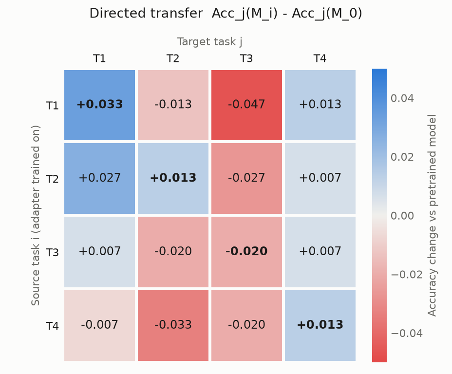

# Multi-task VQA pilot report

## A. Experimental setup

- **Model:** `Qwen/Qwen3.5-4B` (`models/Qwen3.5-4B`), 4-bit NF4 base for E0 and all adapters.
- **Dataset:** GQA v1.2 balanced questions. Train pool and internal validation come from the official train split, and the held-out pilot test comes from the official val split. **This is not a result on the official GQA test benchmark.**
- **Tasks:** T1 query/no relate, T2 query/relate, T3 verify/no relate, T4 verify/relate, using real `semantic[].operation` steps. This is a coarse diagnostic, not a complete measure of reasoning similarity.
- **Training:** LoRA rank 8, alpha 16, lr 0.0001, 400 examples per task, effective batch 8 (micro-batch 1), frozen vision encoder and aligner, non-thinking.
- **Random seed:** 42 (single seed).
- **GPU:** 0, NVIDIA RTX A5000, 24564 MiB, 595.99.02 (eval: e0, e4_no_relate, e4_relate); 2, NVIDIA RTX A5000, 24564 MiB, 595.99.02 (eval: e1_t1, e1_t2, e1_t3, e1_t4, e2_joint); 1, NVIDIA RTX A5000, 24564 MiB, 595.99.02 (eval: e3_query, e3_verify).
- **Completed evaluations:** e0, e1_t1, e1_t2, e1_t3, e1_t4, e2_joint, e3_query, e3_verify, e4_no_relate, e4_relate.
- **Not completed:** none.

Data counts:

| Split | Questions | Images | T1 | T2 | T3 | T4 |
|---|---|---|---|---|---|---|
| train_pool | 4000 | 3905 | 1000 | 1000 | 1000 | 1000 |
| internal_val | 400 | 394 | 100 | 100 | 100 | 100 |
| test | 600 | 584 | 150 | 150 | 150 | 150 |

Training runs:

| Run | Train tasks | Status | GPU | Step | Wall s | s/step | Peak GiB |
|---|---|---|---|---|---|---|---|
| e1_t1 | T1 | finished | 0 | 50/50 | 438 | 8.262023 | 4.15 |
| e1_t2 | T2 | finished | 0 | 50/50 | 429 | 8.097108 | 4.15 |
| e1_t3 | T3 | finished | 2 | 50/50 | 435 | 8.219307 | 4.15 |
| e1_t4 | T4 | finished | 2 | 50/50 | 453 | 8.592408 | 4.15 |
| e2_joint | T1+T2+T3+T4 | finished | 2 | 200/200 | 1680 | 8.274071 | 4.15 |
| e3_query | T1+T2 | finished | 1 | 100/100 | 852 | 8.282616 | 4.15 |
| e3_verify | T3+T4 | finished | 1 | 100/100 | 854 | 8.288208 | 4.15 |
| e4_no_relate | T1+T3 | finished | 1 | 100/100 | 919 | 8.95962 | 4.15 |
| e4_relate | T2+T4 | finished | 0 | 100/100 | 840 | 8.160035 | 4.15 |

Budget note: every task contributes the same examples, so one-, two- and four-task adapters take different numbers of optimizer steps by design (at defaults 50, 100 and 200).

## B. Main results

Exact-match accuracy on the held-out pilot test. E1 uses each target task's own single-task adapter. E3/E4 use oracle routing from dataset metadata.

| Experiment | T1 | T2 | T3 | T4 | Macro Avg | Pooled | Invalid rate |
|---|---|---|---|---|---|---|---|
| E0 pretrained | 0.600 | 0.487 | 0.813 | 0.847 | 0.687 | 0.687 | 0.000 |
| E1 single-task | 0.633 | 0.500 | 0.793 | 0.860 | 0.697 | 0.697 | 0.000 |
| E2 joint | 0.660 | 0.480 | 0.820 | 0.853 | 0.703 | 0.703 | 0.000 |
| E3 question-type | 0.647 | 0.500 | 0.800 | 0.853 | 0.700 | 0.700 | 0.000 |
| E4 operation grouping | 0.660 | 0.507 | 0.813 | 0.860 | 0.710 | 0.710 | 0.000 |

Query tasks (T1, T2) are open-answer; verify tasks (T3, T4) are binary. Prefer per-task and macro values, because pooled accuracy can be distorted by answer format.

## C. Directed transfer

T[i→j] = Acc_j(M_i) − Acc_j(M_0). Rows are source tasks and columns are target tasks. This is source-only cross-task evaluation, **not** joint MTL interference.

| source \ target | T1 | T2 | T3 | T4 |
|---|---|---|---|---|
| T1 | +0.033 | -0.013 | -0.047 | +0.013 |
| T2 | +0.027 | +0.013 | -0.027 | +0.007 |
| T3 | +0.007 | -0.020 | -0.020 | +0.007 |
| T4 | -0.007 | -0.033 | -0.020 | +0.013 |

Positive means the adapter improved the target task over the pretrained model; negative means it degraded it. Asymmetry means T[i→j] differs from T[j→i].

Mean off-diagonal transfer by task relationship (descriptive, four pairs each):

| Relationship | Mean transfer | Pairs available |
|---|---|---|
| same question type (T1-T2, T3-T4) | +0.000 | 4 |
| same operation group (T1-T3, T2-T4) | -0.017 | 4 |
| neither (T1-T4, T2-T3) | -0.010 | 4 |

Same-operation pairs always cross answer format and same-type pairs never do, so this comparison cannot separate reasoning similarity from answer format.

Share of predictions that are yes/no, per E1 adapter. High values on query targets indicate an answer-format shift rather than a reasoning effect:

| source \ target | T1 | T2 | T3 | T4 |
|---|---|---|---|---|
| T1 | 0.000 | 0.000 | 1.000 | 1.000 |
| T2 | 0.000 | 0.000 | 1.000 | 1.000 |
| T3 | 0.000 | 0.000 | 1.000 | 1.000 |
| T4 | 0.000 | 0.000 | 1.000 | 1.000 |

## D. MTL interference

I_i = Acc_i(M_joint) − Acc_i(M_i), with a paired bootstrap 95% CI over test questions. Positive: joint training helped task i. Negative: it hurt task i. E2 is naive joint training, used as a baseline and not a new method.

| Task | E2 joint | E1 single-task | I_i [95% CI] |
|---|---|---|---|
| T1 | 0.660 | 0.633 | +0.027 [-0.020, +0.073] |
| T2 | 0.480 | 0.500 | -0.020 [-0.053, +0.013] |
| T3 | 0.820 | 0.793 | +0.027 [-0.033, +0.087] |
| T4 | 0.853 | 0.860 | -0.007 [-0.047, +0.033] |

Directed transfer does not necessarily predict joint interference; the two measure different training conditions.

## E. Preliminary idea assessment

E4 − E3 with paired bootstrap 95% CIs. Both use two adapters and corresponding budgets, making this the closer comparison. Compared with E2, both have more total adapter capacity, so any gain over E2 may reflect specialization or capacity rather than grouping alone.

| Target | E3 | E4 | E4 − E3 [95% CI] |
|---|---|---|---|
| T1 | 0.647 | 0.660 | +0.013 [-0.027, +0.060] |
| T2 | 0.500 | 0.507 | +0.007 [-0.027, +0.040] |
| T3 | 0.800 | 0.813 | +0.013 [-0.027, +0.053] |
| T4 | 0.853 | 0.860 | +0.007 [-0.013, +0.033] |
| Macro (T1-T4) | 0.700 | 0.710 | +0.010 [-0.008, +0.028] |
| Query macro (T1, T2) | 0.573 | 0.583 | +0.010 [-0.017, +0.040] |
| Verify macro (T3, T4) | 0.827 | 0.837 | +0.010 [-0.013, +0.033] |

E3 adapters each see one answer format, while E4 adapters must learn both. The E3 versus E4 comparison therefore also tests answer-format specialization. One small run cannot establish that any grouping or architecture is superior, and E4 does not validate the general reasoning-operation hypothesis.

## F. Limitations

- **Question type vs answer format:** `query`/`verify` is confounded with open vs yes/no answers.
- **Small number of tasks:** four groups support feasibility, not a general taxonomy claim.
- **Limited training:** few optimizer steps, and step counts differ by number of tasks.
- **Single checkpoint** and **single random seed:** CIs cover test-question sampling only, not training variation.
- **Coarse grouping:** presence of `relate` is one operation among many, and it correlates with program length.
- **Oracle routing:** E3/E4 route by dataset metadata and are not automatic routing systems.
- **Transfer vs MTL:** source-only transfer (E1) and joint training (E2) are different conditions.
- **Adapter capacity:** E3/E4 use two adapters and E2 uses one.
- **Quantized base:** all results use the 4-bit model, which may differ from full-precision accuracy.
- **No benchmark reproduction:** this is a controlled pilot motivated by prior work, not a reproduction of VQACL, the official GQA benchmark or any other paper.

## G. Research decision

**Inconclusive.** E4 minus E3 macro accuracy is +0.010 (95% CI -0.008 to +0.028); the interval includes zero. Improve task design or repeat with more seeds.

Rule fixed before running: Promising if the E4 − E3 macro CI is above zero, Not supported if below zero, otherwise Inconclusive; Inconclusive if invalid generations exceed 10%. This is a mechanical output that should be reviewed against sections C to F. A positive result would justify larger experiments only.
